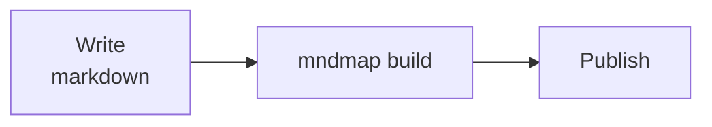

# Flows

A flow is a Mermaid flowchart in a ```` ```mermaid ```` fence. mndmap reads it with Mermaid's own parser, so any flowchart Mermaid accepts is accepted here, and the fence still renders as Mermaid wherever mndmap has not run (GitHub, an editor preview).

## Writing one

````markdown

````


- a `click` line links a node to a page: see [Linking](linking.md)
- `<br>` breaks a label; the first line is set stronger
- the nearest heading above the fence titles the diagram's own page

## What is drawn

| Mermaid | Drawn as |
|---|---|
| `A[text]`, `A(text)`, `A([text])` | a card: square, round or stadium corners |
| `A{text}`, `A{{text}}` | a decision diamond, a hexagon |
| `A[(text)]`, `A[[text]]`, `A((text))` | a cylinder, a subroutine, a circle |
| `A[/text/]`, `A[\text\]`, `A[/text\]` | a parallelogram either way, a trapezoid |
| `-->`, `---`, `-.->`, `==>`, `<-->` | a route with or without heads, dotted or thick |
| `-- label -->` | the label on the route |
| `subgraph id [Title] … end` | a box round its members, titled top-left |
| `flowchart LR / RL / TB / BT` | the direction it reads |

Styling lines (`classDef`, `style`, `linkStyle`) are read but not drawn: every flow wears one look, so a site's diagrams read as one set.

## The look

| Mark | Means |
|---|---|
| a card's border in a folder's colour | the node links to a page in that folder |
| a page icon top-right | links to a page; an arrow means an outside address |
| a dashed border in warn, `!` | the link names no page; the build reports it |
| the accent outline | hovered, or lit as a neighbour of the hovered node |

Other Mermaid diagrams (sequence, class, state, …) are left in the page as written, for the site to render.
