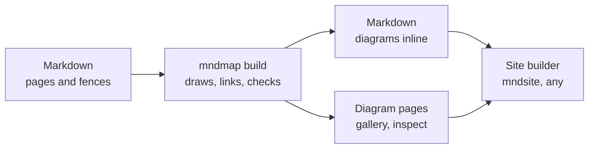

# mndmap

Cards and diagrams for static documentation, drawn from the markdown it is published from. Add a `cards` fence and a page becomes a deck of bite-sized cards, one per heading, that open to show their parts and draw their relationships; a Mermaid flowchart or a `sitemap` fence is drawn the same way. mndmap links everything to the site's pages, checks the links, and hands the site back as markdown for any static site builder to publish.

## Site map

Every page of these docs, sized by how much it says and grouped by folder. Each page and section is a link.

```sitemap
```

## How it works



| Part | Does |
|---|---|
| [Cards](guide/cards.md) | a page as a deck of cards, one per heading, read one at a time |
| [Flows](guide/flows.md) | Mermaid flowcharts, drawn in mndflow's look, nodes linked to pages |
| [Site maps](guide/sitemaps.md) | the site as a treemap: folders as boxes, pages as chips, sections as links |
| [Linking](guide/linking.md) | how a node names a page, and how broken links are caught |
| [Embedding](guide/embedding.md) | static SVG or an interactive frame; each diagram's own page |
| [CLI](reference/cli.md) and [configuration](reference/config.md) | `mndmap build`, `mndmap check`, `mndmap.yaml` |
